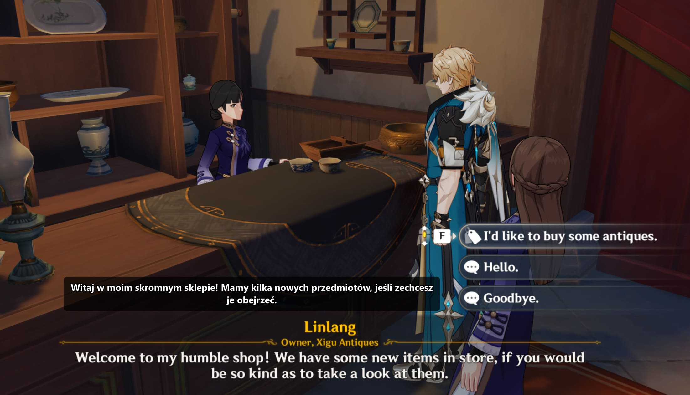
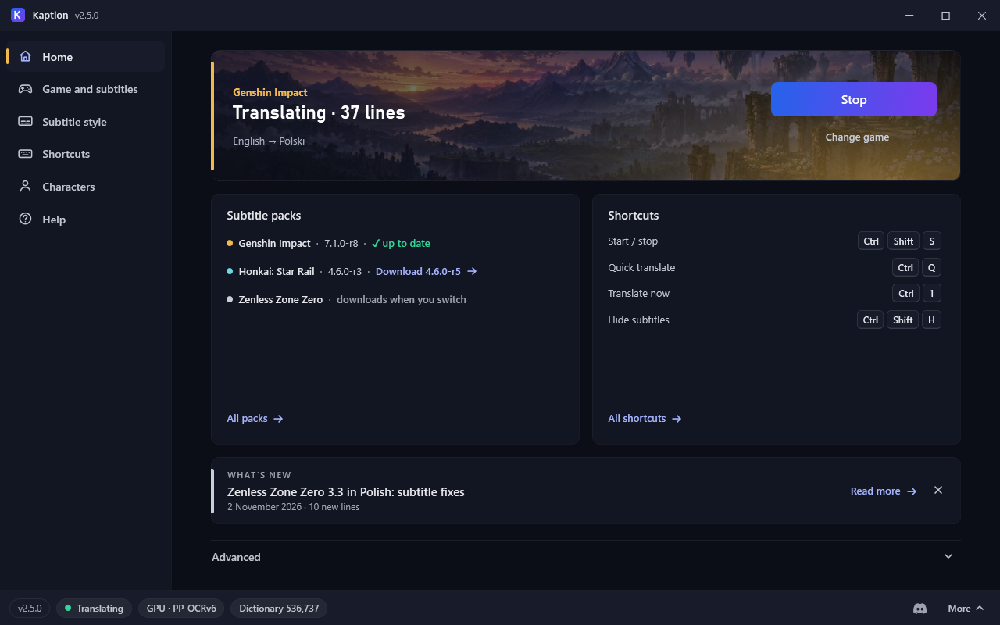

# Kaption

[](https://github.com/wojciechowskiapp/Kaption/actions/workflows/ci.yml)
[](https://github.com/wojciechowskiapp/Kaption/actions/workflows/codeql.yml)
[](./LICENSE)

Kaption shows Polish subtitles over the dialogue in Genshin Impact, Honkai: Star Rail and Zenless Zone Zero. It reads the dialogue box from your screen and draws the translation on top, without touching the game's files or memory.

**[Download for Windows](https://kaption.one/#download)** · [kaption.one](https://kaption.one)



## Supported games

- Genshin Impact
- Honkai: Star Rail
- Zenless Zone Zero

## How it works

1. Kaption captures the part of the screen where the game shows dialogue.
2. It reads the text on your own PC, on the graphics card when it can.
3. It finds that line in the game's own dialogue data, even when a few letters were misread.
4. It draws the Polish line in a small overlay just above the dialogue box.

## Requirements

- Windows 10 version 2004 or later, 64-bit, on a CPU with AVX
- A DirectX 12 graphics card is recommended; without one, reading runs on the processor, more slowly
- About 500 MB of disk space for the subtitle packs

The installer brings the .NET runtime with it, and Kaption updates itself.

## Features in 2.5



- Auto-start: Kaption starts translating when the game is on screen and stops when you close it.
- New subtitles: a clearer typeface that stays readable over bright scenes, and Wygląd napisów (Subtitle style) with a true-scale preview and three styles.
- Setup in one window: language, game, sign-in and the first subtitle download, one step after another.
- Postacie (Characters): skills, builds and materials for every character in the three games, with game terms in English and the Polish next to them.
- Ctrl+Q quick translate: select any panel in the game, read it in Polish, and open the card of the character Kaption recognised.
- Polish subtitle packs for all three games, refreshed after each game patch.

## Privacy

Your screen is read on your own computer and screen images never leave it; subtitle packs are encrypted for your machine. Crash reports stay off unless you turn them on in Pomoc › Prywatność (Help › Privacy), and [docs/PRIVACY.md](./docs/PRIVACY.md) explains what the app sends and when.

## Building

Windows and the [.NET 10 SDK](https://dotnet.microsoft.com/download) (10.0.403 or newer) are all you need:

```
dotnet build GI-Subtitles.sln -c Release
dotnet test GI-Test/GI-Test.csproj -c Debug
```

Settings live in `%APPDATA%\Kaption\Config.json`, described key by key in [docs/CONFIG.md](./docs/CONFIG.md). Where the code lives and how to send a change: [CONTRIBUTING](./.github/CONTRIBUTING.md). Security reports: [SECURITY](./.github/SECURITY.md).

## Licence

Kaption is dual-licensed under [AGPL-3.0](./LICENSE-AGPL) or a [commercial licence](./LICENSE-COMMERCIAL); [LICENSE](./LICENSE) explains which applies. Third-party components and their licences are listed in [THIRD_PARTY_LICENSES.txt](./THIRD_PARTY_LICENSES.txt). If you ship a fork, please give it its own name and icon.

## Credits

Kaption began as a fork of [qew21/Genshin-Subtitles](https://github.com/qew21/Genshin-Subtitles) (Apache-2.0), where the idea of reading the dialogue and looking it up in the game's text came from. Every line is matched against game data maintained by [Dimbreath](https://www.patreon.com/c/dimbreath/posts): [AnimeGameData2](https://gitlab.com/Dimbreath/animegamedata2), [turnbasedgamedata](https://gitlab.com/Dimbreath/turnbasedgamedata) and [ZenlessData](https://git.mero.moe/dimbreath/ZenlessData). If that work helps you too, please support it. Kaption is built on PaddleOCR, ONNX Runtime, OpenCV, Velopack, Lucene.NET and Sentry.

Kaption is independent and not affiliated with HoYoverse, Cognosphere or miHoYo.
